# Job Tracker

**An AI-powered job application tracker.** It scores how well you match a job, writes a tailored CV as a PDF, and answers questions about your applications in plain English.

> **About the demo data:** every name, company, email and job in the screenshots and the video is **fake demo data**, made only for this showcase.

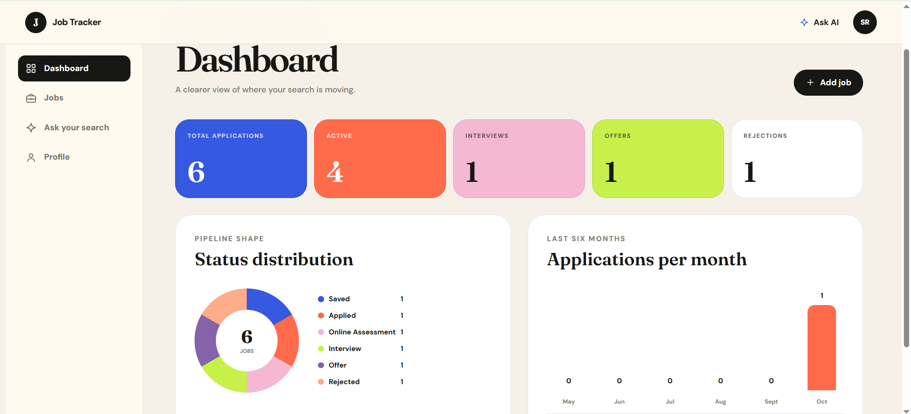

**Demo video:** LinkedIn: [Salma Rahel](https://www.linkedin.com/in/salma-r-7b0716290)

---

## What it does

- **Track applications.** Save jobs and move them through 8 statuses: Saved, Applied, Online Assessment, Interview, Final Interview, Offer, Rejected, Withdrawn.
- **AI match analysis.** Gemini compares your profile with a job description and returns a score from 0 to 100, a label (Strong, Moderate, Weak) and the missing requirements.
- **Tailored CV.** Generates a one-page PDF CV built from your profile and focused on the job. Two templates (plain and ATS-friendly, or colored sidebar) and three color palettes.
- **Ask your job search.** Ask questions like "Which Remote positions do I have?" and get an answer in plain English.
- **Live updates.** Long AI tasks run in the background. The page updates by itself when they finish, with no refresh.

---

## Screenshots

**Landing page.** The entry point of the app.

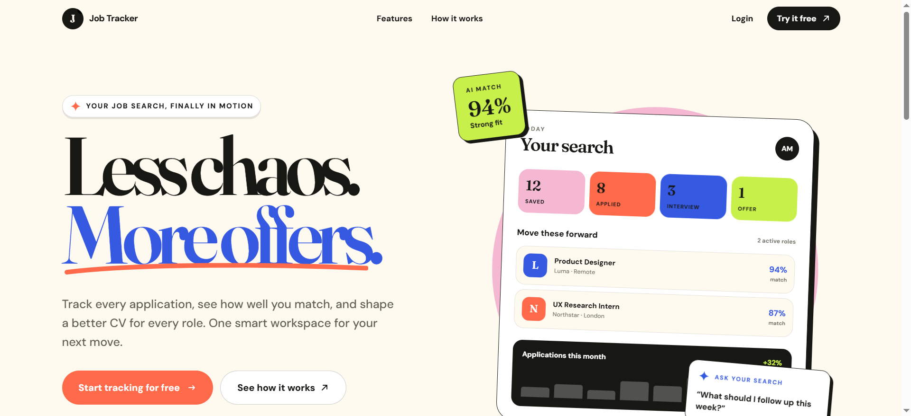

**Login and register.** Create an account or sign in.

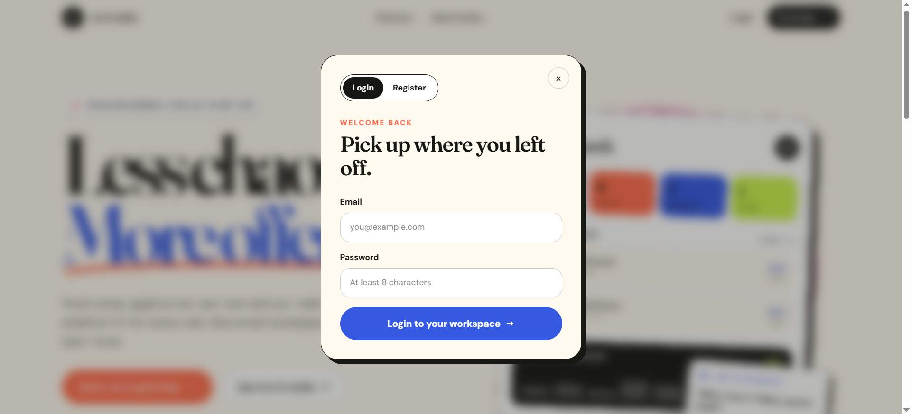

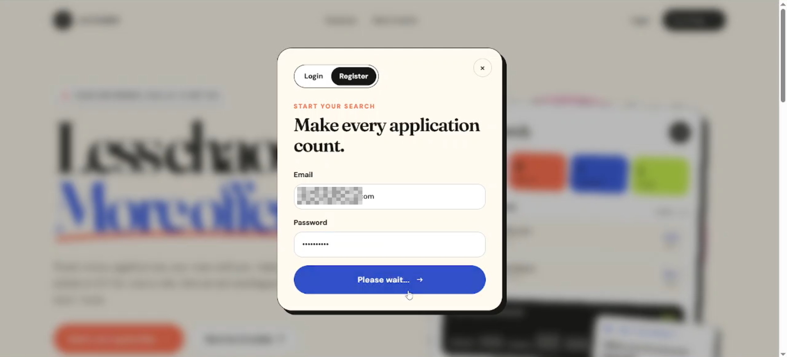

**Jobs board.** Search, filter by status, and see deadlines at a glance.

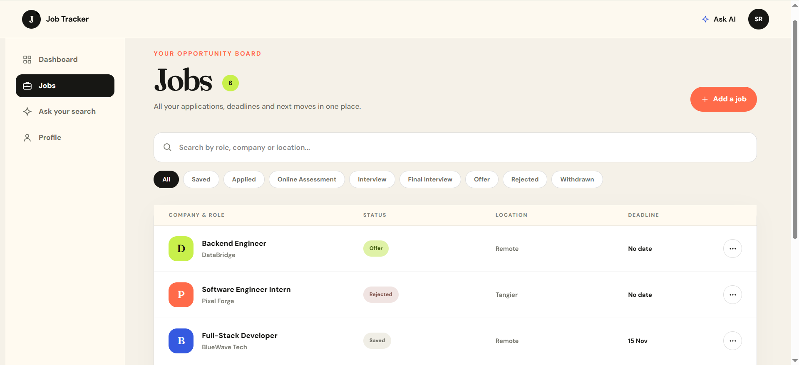

**Profile.** The single source of facts for the match and the CV. AI features unlock after 3 skills.

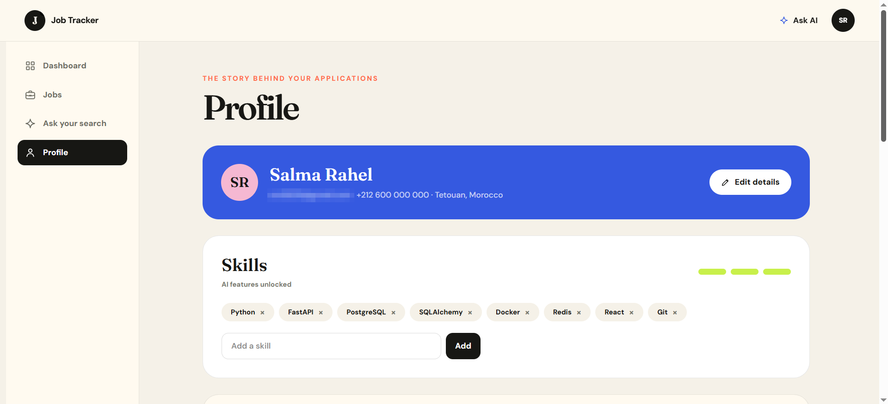

**Certifications and links.**

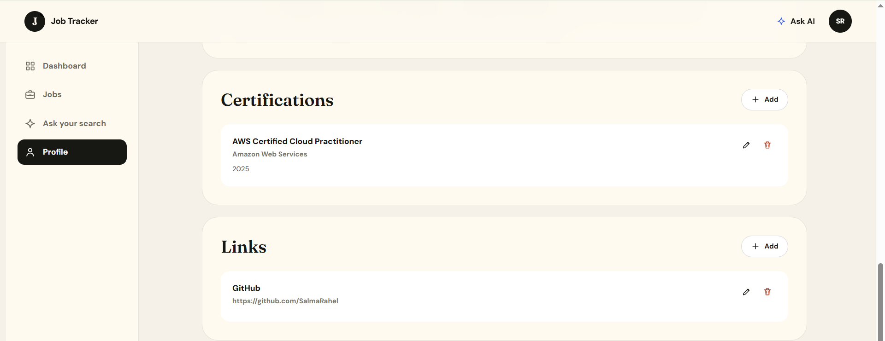

**Projects.** Each project keeps its technologies and a description.

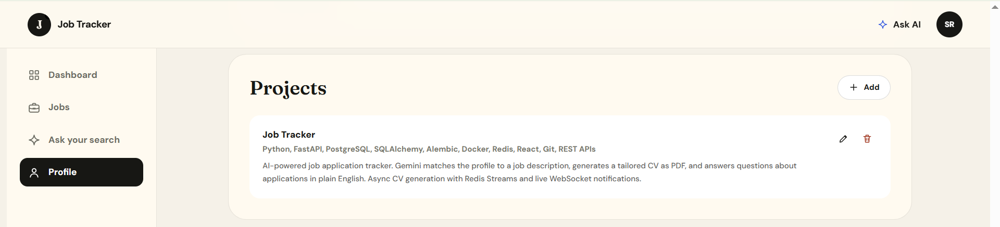

**AI match analysis and tailored CV.** Score, label and missing requirements on the left. Template and palette choice on the right.

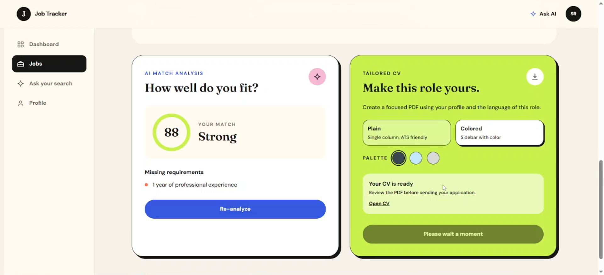

**Generated CV.** A one-page PDF with the colored sidebar template.

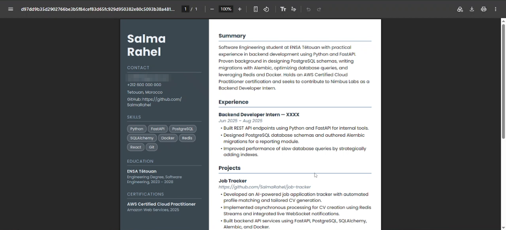

**Ask your job search.** A plain-English question, a plain-English answer.

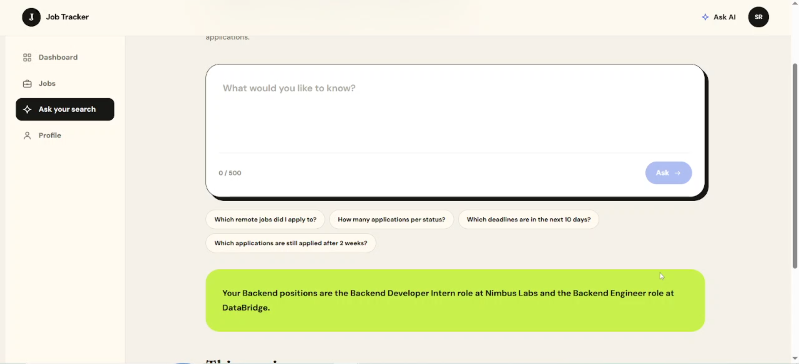

---

## Architecture

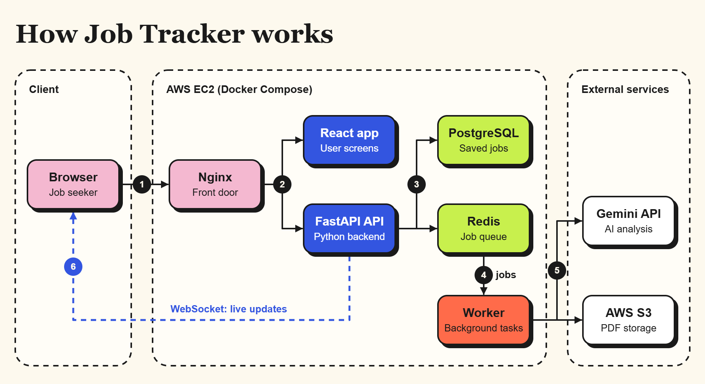

- **Frontend:** React app, served by Nginx.
- **API:** FastAPI, with PostgreSQL for data and Redis for the job queue.
- **Worker:** a separate process that does the slow work (Gemini calls, PDF creation, S3 upload).
- **Live updates:** the API pushes results to the browser through a WebSocket.

---

## Key engineering decisions

### 1. Slow AI work runs in the background

Generating a CV takes several seconds, so the API does not wait for it. It answers **202 Accepted** at once, puts the job in a **Redis Stream**, and a worker picks it up. When it finishes, the browser is notified through a WebSocket.

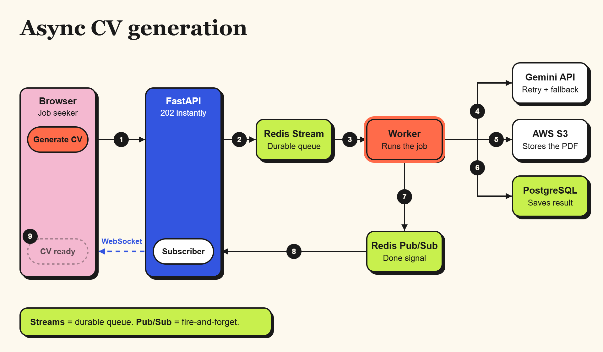

- **Redis Streams** is a durable queue. A job is not lost if the worker is busy or restarts.
- **Redis Pub/Sub** is fire-and-forget, which is enough for a "done" notification.
- One shared worker handles both matching and CV jobs, and every job is tracked in one `background_jobs` table.

### 2. Natural-language questions are safe by design

A user's question becomes SQL, so security comes first. Several layers protect the database:

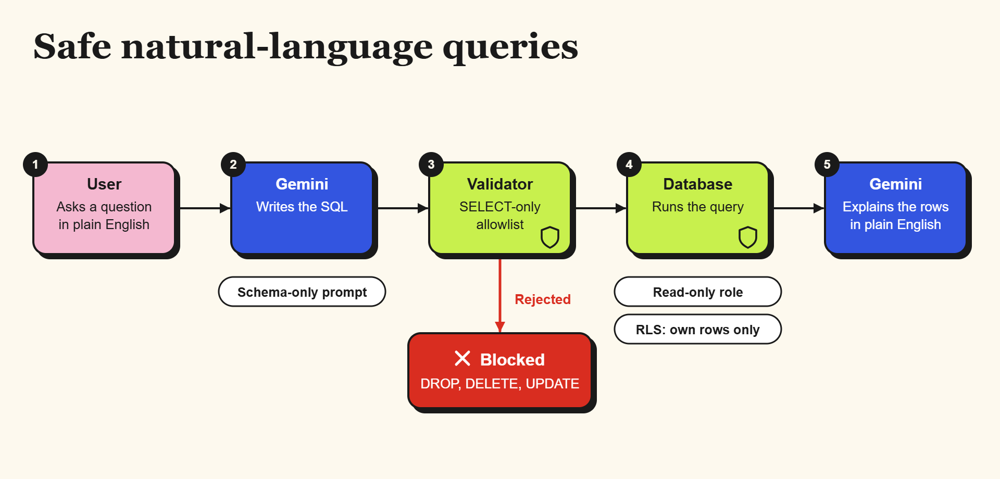

- The Gemini prompt only knows the database schema.
- A validator accepts **SELECT only** and rejects DROP, DELETE and UPDATE.
- The query runs with a **read-only database role**.
- **Row-Level Security** makes sure a user only sees their own rows.

### 3. AI with guardrails

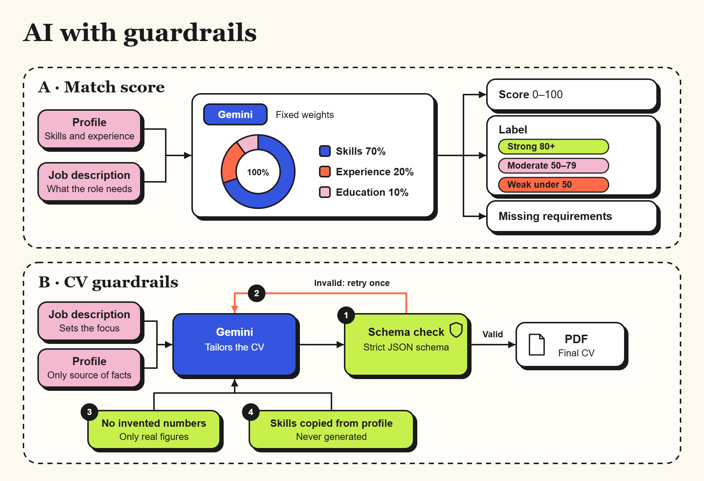

- The match score uses **fixed weights**: skills 70%, experience 20%, education 10%.
- Scores are **consistent**: temperature is 0, and results are cached in Redis by a hash of the job description and the profile.
- The CV is tailored to the job description, but the **profile is the only source of facts**. The output must pass a strict JSON schema, with one self-correction retry.
- Skills are copied from the profile, never invented.
- The Gemini wrapper retries on errors and falls back to a lighter model when the main one is busy (503 or 429).

### 4. No AWS keys in the app

On the server, the app reads and writes S3 through an **IAM role** attached to the EC2 instance. There are no access keys in the code, in the config or in the compose files. PDFs are shared with short-lived presigned URLs.

---

## Tech stack

- **Frontend:** React 19, TypeScript, Vite, Tailwind CSS 4
- **Backend:** Python, FastAPI, SQLAlchemy, Alembic
- **Data:** PostgreSQL 16, Redis 7 (Streams and Pub/Sub)
- **AI:** Google Gemini API
- **PDF:** WeasyPrint with HTML templates
- **Infrastructure:** Docker Compose, Nginx, Terraform, AWS (EC2, S3, IAM)
- **CI/CD:** GitHub Actions
- **Tests:** pytest, about 397 backend tests

---

## Deployment and CI/CD

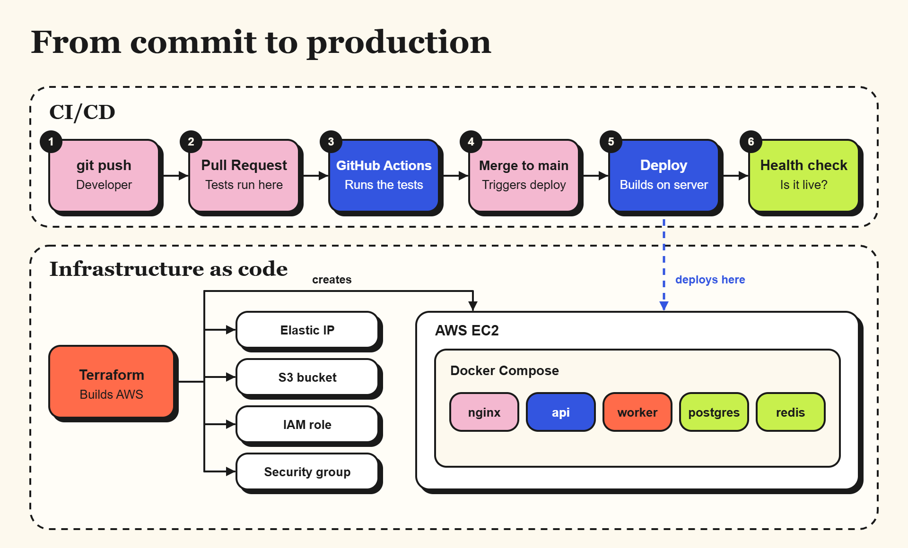

- **Terraform** creates the AWS setup: EC2 server, Elastic IP, S3 bucket, IAM role and security group.
- **GitHub Actions** runs the tests on every pull request. When a change is merged to `main`, it deploys to the server over SSH and runs a health check.
- The server runs 5 containers with Docker Compose: nginx, api, worker, postgres and redis.

> The app was deployed on AWS (EC2 and S3, region eu-north-1) for a live demo, then **taken down to save cost**. The Terraform code in `infra/` can recreate it with one command.

---

## Run it locally

You need Docker Desktop and a Gemini API key.

1. Clone the repo:
   ```
   git clone https://github.com/SalmaRahel/job-tracker.git
   cd job-tracker
   ```
2. Create your environment files from the examples:
   ```
   copy .env.example .env
   copy backend\.env.prod.example backend\.env.prod
   ```
   On macOS or Linux, use `cp` instead of `copy`. Then fill in the values (database passwords, `GEMINI_API_KEY`). The database values must match in both files.
3. Build and start everything:
   ```
   docker compose -f docker-compose.prod.yml up -d --build
   ```
4. Open `http://localhost`.

Database migrations run automatically on start. See [DEPLOY.md](DEPLOY.md) for logs, stopping and resetting the stack.

> **Note:** CV PDF generation uploads to S3, so it needs an S3 bucket and AWS access. Without it, everything else works, and only the CV step fails.

---

## Project structure

- `backend/` – FastAPI app, background worker, migrations, tests
- `frontend/` – React app
- `nginx/` – reverse proxy config (HTTP and WebSocket)
- `infra/` – Terraform code for AWS
- `.github/workflows/` – CI and deploy pipelines
- `docker-compose.prod.yml` – the full stack
- `DEPLOY.md` – run and deploy guide

---

## Author

**Salma Rahel**, Software Engineering student at ENSA Tétouan (Morocco).
GitHub: [SalmaRahel](https://github.com/SalmaRahel)
LinkedIn: [Salma Rahel](https://www.linkedin.com/in/salma-r-7b0716290)

Feedback is welcome. What would you improve?
